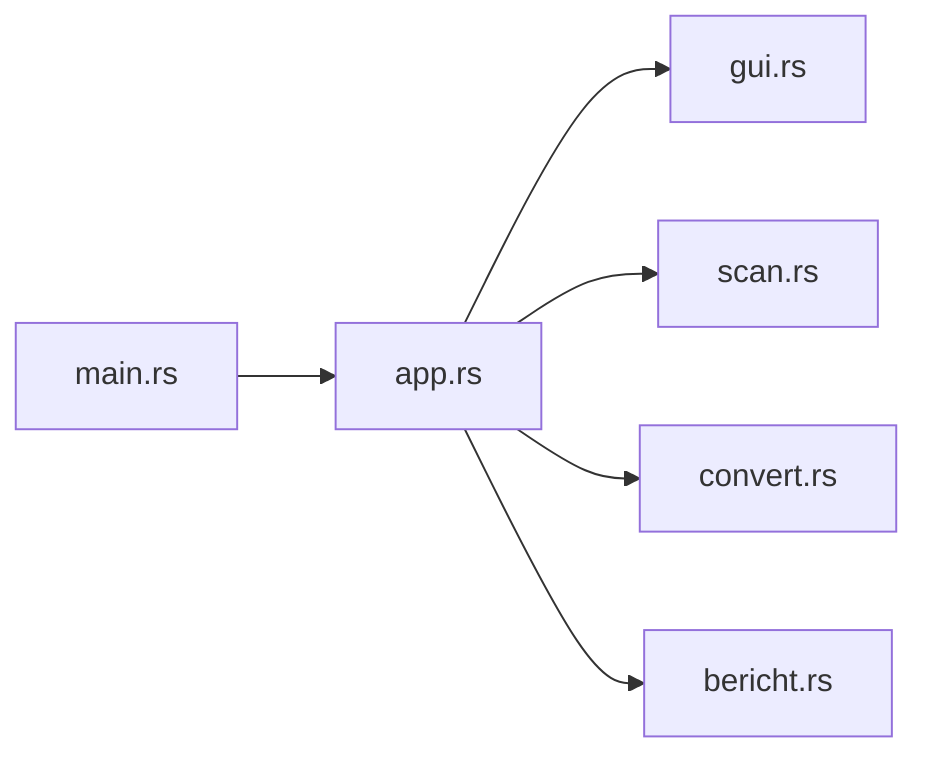

# Entscheidungen

| Entscheidung | Grund |
|---|---|
| Rust + egui | kleine, schnelle Einzeldatei |
| ffmpeg statt Audacity | Audacity nur per mod-script-pipe, instabil bei vielen Dateien |
| Eigener Konverter später | ffmpeg nicht mehr mitliefern |
| Zuerst nur Windows 11 | macOS/Linux später per GitHub Actions |
| Ein Zielformat-Dropdown für alle | einfacher als je Datei |
| MP3-Quellen immer gesperrt | MP3 nicht erneut umwandeln |
| Zieldateien nie überschreiben | Datenverlust vermeiden |
| MP3 mit ID3v2.3 | beste Player-Kompatibilität |
| Dither beim Runterrechnen auf 16 Bit | saubereres Ergebnis |
| Eine `main.rs` | reicht bis ca. 500 Zeilen |

## Geplante Module

`convert.rs` ist die Stelle, an der ffmpeg später durch den eigenen Konverter getauscht wird.
