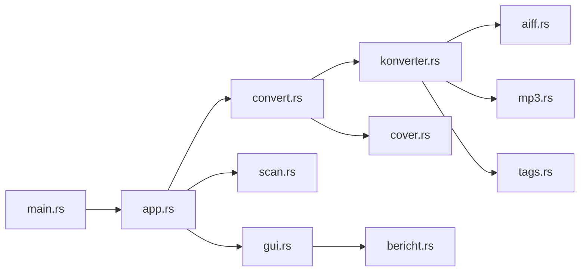

# Entscheidungen

| Entscheidung | Grund |
|---|---|
| Rust + egui | kleine, schnelle Einzeldatei |
| ffmpeg statt Audacity | Audacity nur per mod-script-pipe, instabil bei vielen Dateien |
| Eigener Konverter statt ffmpeg | keine zweite Programmdatei nötig, Standalone ist einfacher |
| Zuerst nur Windows 11 | macOS/Linux später per GitHub Actions |
| Ein Zielformat-Dropdown für alle | einfacher als je Datei |
| MP3-Quellen immer gesperrt | MP3 nicht erneut umwandeln |
| Zieldateien nie überschreiben | Datenverlust vermeiden |
| MP3 mit ID3v2.3 | beste Player-Kompatibilität |
| Dither nur bei AIFF und nur wenn Bits wegfallen | 16-Bit-Quellen mit 44,1 kHz bleiben bitgenau |
| LAME eingebaut (mp3lame-encoder) | MP3 ohne ffmpeg |
| symphonia zum Lesen, rubato zum Umrechnen | reine Rust-Bibliotheken, kein externes Programm |
| Zieldatei mit `create_new` öffnen | vorhandene Datei kann nicht überschrieben werden |
| Code in Module aufgeteilt | eine `main.rs` wäre mit den offenen Punkten zu groß geworden |
| Nr zählt alle Zeilen | gesperrte Dateien bleiben sichtbar, Nr passt zur Gesamtzahl |
| CSV mit Semikolon, ohne Anführungszeichen | deutsches Excel öffnet das direkt in Spalten |
| Semikolon im Text wird zu Komma | sonst verrutschen die Spalten |
| BOM am Dateianfang | Umlaute in Excel korrekt |
| Protokoll-Knopf erst nach einem Lauf | ein Protokoll ohne Lauf wäre leer |
| Standalone-Datei wie `cargo run --release` | Messung: 60 Tracks (WAV und FLAC) nach AIFF in 19 s im Release-Build. Im Debug-Build ist der eigene Konverter deutlich langsamer. Die Standalone-Datei muss also optimiert gebaut werden. |

## Module

| Modul | Inhalt |
|---|---|
| `main.rs` | nur Start |
| `app.rs` | `App`, `Datei`, `Bild`, `Status`, Ordner, Start, Abbruch, Nachrichten |
| `gui.rs` | Seitenleiste, Tabelle, Fußleiste, Bilderliste, Fenster „Ordner ohne Bild“ |
| `scan.rs` | liefert Pfade für Audio- und Bilddateien |
| `convert.rs` | `Ziel`, `Msg`, Sperrregel, Hintergrund-Thread |
| `konverter.rs` | lesen, auf 44,1 kHz umrechnen, auf 16 Bit runden |
| `aiff.rs` | AIFF schreiben |
| `mp3.rs` | MP3 schreiben (LAME, 320 kbit/s) |
| `tags.rs` | Tags und Cover als ID3 |
| `cover.rs` | Cover im Quellordner suchen |
| `bericht.rs` | CSV-Protokoll erzeugen und speichern |
