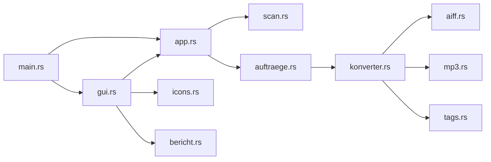

# Entscheidungen

| Entscheidung | Grund |
|---|---|
| Rust + egui | kleine, schnelle Einzeldatei |
| ffmpeg statt Audacity | Audacity nur per mod-script-pipe, instabil bei vielen Dateien |
| Eigener Konverter statt ffmpeg | keine zweite Programmdatei nötig, Standalone ist einfacher |
| Zuerst nur Windows 11 | macOS/Linux später per GitHub Actions |
| Ein Zielformat-Dropdown für alle | einfacher als je Datei |
| MP3-Quellen immer gesperrt | MP3 nicht erneut umwandeln |
| Zieldateien nie überschreiben | Datenverlust vermeiden |
| MP3 mit ID3v2.3 | beste Player-Kompatibilität |
| Dither nur bei AIFF und nur wenn Bits wegfallen | 16-Bit-Quellen mit 44,1 kHz bleiben bitgenau |
| LAME eingebaut (mp3lame-encoder) | MP3 ohne ffmpeg |
| symphonia zum Lesen, rubato zum Umrechnen | reine Rust-Bibliotheken, kein externes Programm |
| Code in Module aufgeteilt | eine `main.rs` wäre mit den offenen Punkten zu groß geworden |
| Nr zählt alle Zeilen | gesperrte Dateien bleiben sichtbar, Nr passt zur Gesamtzahl |
| CSV mit Semikolon, ohne Anführungszeichen | deutsches Excel öffnet das direkt in Spalten |
| Semikolon im Text wird zu Komma | sonst verrutschen die Spalten |
| BOM am Dateianfang | Umlaute in Excel korrekt |
| Protokoll-Knopf erst nach einem Lauf | ein Protokoll ohne Lauf wäre leer |
| Mehrere Dateien gleichzeitig, ein Thread pro Kern | LAME nutzt nur einen Kern; 60 Tracks nach MP3 dauerten 6:30 min |
| Standalone-Datei wie `cargo run --release` | Messung: 60 Tracks (WAV und FLAC) nach AIFF in 19 s im Release-Build. Im Debug-Build ist der eigene Konverter deutlich langsamer. Die Standalone-Datei muss also optimiert gebaut werden. |
| Ziel mit `create_new` anlegen, nur selbst angelegte Dateien löschen | nie überschreiben; bei parallelen Aufträgen mit gleichem Ziel (`a.wav` und `a.flac`) wird nie eine fremde Datei gelöscht |
| Abgebrochene Datei wird wieder „bereit“ | sie wurde gelöscht, ist also kein Fehler |
| Cover kommt aus der Bilderliste der App | eine Quelle der Wahrheit für Fenster „Cover“ und Einbetten |
| Lucide-Icons (Iconify), als SVG über `egui_extras` | schlicht, einheitlich, ISC-Lizenz; weiß gespeichert und eingefärbt |
| Feste Akzentfarbe für die Hauptaktion | Weiß auf Blau ist in hellem und dunklem Thema lesbar |
| Format als eine Spalte („FLAC → AIFF“), Ordner kurz ab Quellordner | kompakte Tabelle, voller Pfad als Tooltip und im Protokoll |
| Nur sichtbare Zeilen zeichnen | flüssig auch bei tausenden Dateien |
| Tests im Projekt (`cargo test --release`) | Bitgenauigkeit, Länge, MP3, Cover, Abbruch, vorhandene Dateien |
| Zielformate AIFF (16 Bit, 44,1 kHz) und MP3 (320 kbit/s), keine Playerauswahl | alle geprüften Pioneer- und Denon-Player spielen beide Formate (Liste in `dj-player.md`); eine Auswahl würde am Ergebnis nichts ändern (KISS, YAGNI) |

## Module

| Modul | Inhalt |
|---|---|
| `main.rs` | Start, Ordner aus Programm-Argumenten |
| `app.rs` | `App`, `Datei`, `Bild`, `Status`, Ordner, Auswahl, Start, Abbruch, Zusammenfassung |
| `gui.rs` | Stil, Werkzeugleiste, Quellen, Tabelle, Statusleiste, Fenster „Cover“, Drag & Drop |
| `icons.rs` | Lucide-Icons |
| `scan.rs` | Audio- und Bilddateien in einem Durchlauf finden |
| `auftraege.rs` | Aufträge parallel im Hintergrund, Nachrichten an die Oberfläche |
| `konverter.rs` | `Ziel`, Sperrregel, lesen, auf 44,1 kHz umrechnen, auf 16 Bit runden |
| `aiff.rs` | AIFF schreiben |
| `mp3.rs` | MP3 schreiben (LAME, 320 kbit/s) |
| `tags.rs` | Tags und Cover als ID3 |
| `bericht.rs` | CSV-Protokoll |
