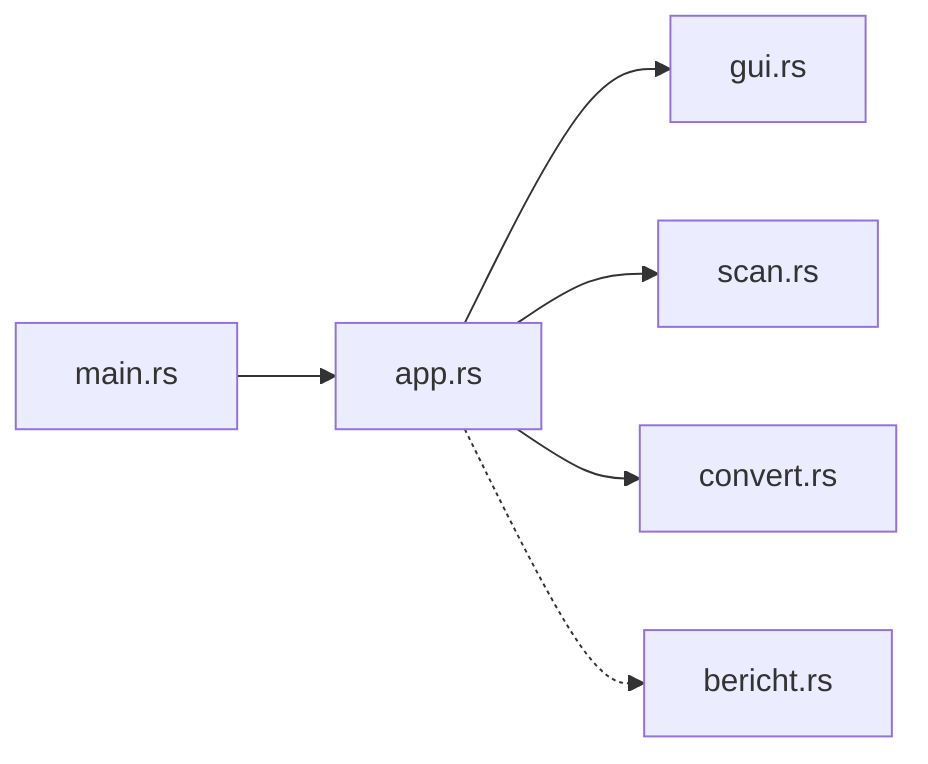

# Entscheidungen

| Entscheidung | Grund |
|---|---|
| Rust + egui | kleine, schnelle Einzeldatei |
| ffmpeg statt Audacity | Audacity nur per mod-script-pipe, instabil bei vielen Dateien |
| Eigener Konverter später | ffmpeg nicht mehr mitliefern |
| Zuerst nur Windows 11 | macOS/Linux später per GitHub Actions |
| Ein Zielformat-Dropdown für alle | einfacher als je Datei |
| MP3-Quellen immer gesperrt | MP3 nicht erneut umwandeln |
| Zieldateien nie überschreiben | Datenverlust vermeiden |
| MP3 mit ID3v2.3 | beste Player-Kompatibilität |
| Dither beim Runterrechnen auf 16 Bit | saubereres Ergebnis |
| Code in Module aufgeteilt | eine `main.rs` wäre mit den offenen Punkten zu groß geworden |
| `bericht.rs` zunächst leer | YAGNI, Datei existiert nur als Platzhalter |

## Module

| Modul | Inhalt |
|---|---|
| `main.rs` | nur Start |
| `app.rs` | `App`, `Datei`, `Status`, Ordner, Start, Abbruch, Nachrichten |
| `gui.rs` | Seitenleiste, Tabelle, Fußleiste, Farben, Statustexte |
| `scan.rs` | liefert nur Pfade, `app.rs` baut daraus `Datei` |
| `convert.rs` | `Ziel`, `Msg`, Sperrregel, ffmpeg-Suche, Thread, Aufruf |
| `bericht.rs` | Platzhalter für das Protokoll |

`convert.rs` ist die Stelle, an der ffmpeg später durch den eigenen Konverter getauscht wird, ohne die Oberfläche anzufassen.
