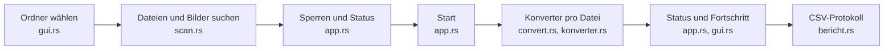
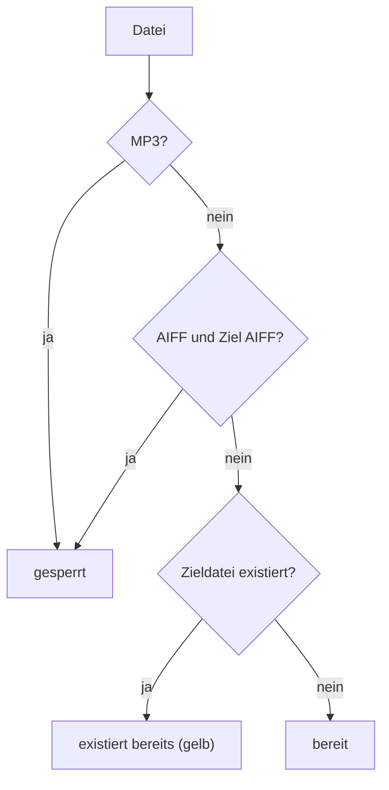
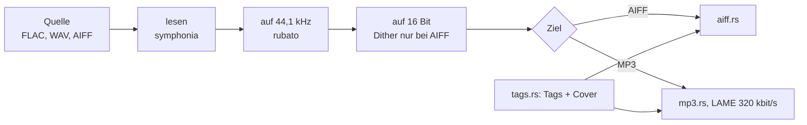

# Funktionen

- Ganze Ordner wählen, Unterordner werden durchsucht, mehrere Ordner möglich
- Quellen: FLAC, WAV, AIFF, MP3
- Tabelle: Nr, Datei, Pfad, Von, Nach, Status; gleicher Ordner = gleiche Zeilenfarbe
- Nr zählt ab 1, die Gesamtzahl steht oben
- Häkchen pro Datei zum Ausnehmen
- Zielformat per Dropdown: AIFF 16 Bit 44,1 kHz oder MP3 320 kbit/s 44,1 kHz
- Ziel liegt im Ordner der Quelle, Originale bleiben unverändert
- Start, Abbrechen, Fortschrittsbalken; Fehlertext per Mouseover
- Protokoll als CSV (Knopf nach einem Lauf): `nr;datei;Ordner/Pfad;von;nach;status`
- Gefundene Bilder werden aufgelistet (einklappbar), nie konvertiert
- Knopf „Ordner ohne Bild“ öffnet ein Fenster mit Ordnern ohne Cover
- Bei AIFF wird das erste Bild im Quellordner als Cover eingebettet

## Ablauf

## Sperren

Die Regel steht in `convert.rs` (`ist_gesperrt`), die Statusvergabe in `app.rs`.

## Umwandlung

