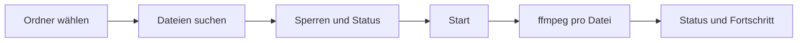
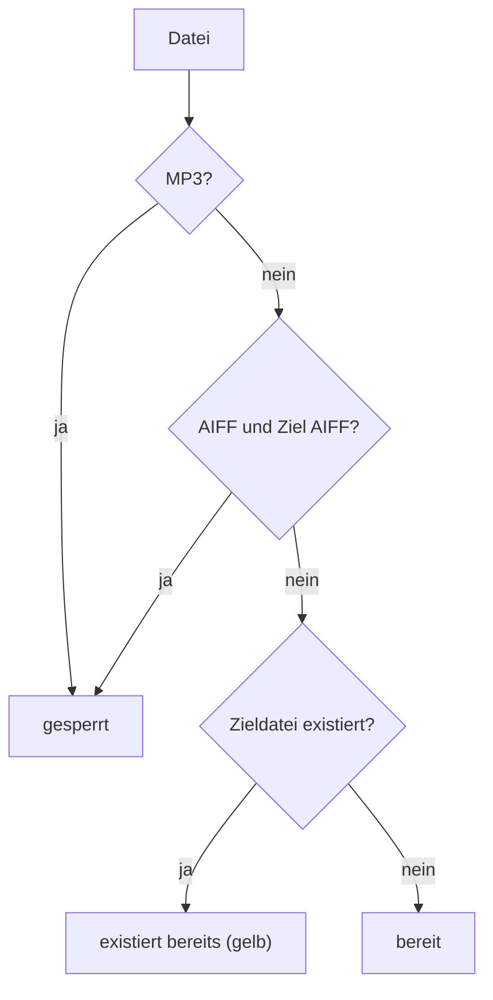

# Funktionen

- Ganze Ordner wählen, Unterordner werden durchsucht, mehrere Ordner möglich
- Quellen: FLAC, WAV, AIFF, MP3
- Tabelle: Datei, Pfad, Von nach, Status; gleicher Ordner = gleiche Zeilenfarbe
- Häkchen pro Datei zum Ausnehmen
- Zielformat per Dropdown: AIFF 16 Bit 44,1 kHz oder MP3 320 kbit/s 44,1 kHz
- Ziel liegt im Ordner der Quelle, Originale bleiben unverändert
- Start, Abbrechen, Fortschrittsbalken; Fehlertext per Mouseover

## Ablauf

## Sperren

## ffmpeg-Befehle

| Ziel | Optionen |
|---|---|
| AIFF | `-af aresample=osr=44100:osf=s16:dither_method=triangular -c:a pcm_s16be -write_id3v2 1` |
| MP3 | `-ar 44100 -c:a libmp3lame -b:a 320k -id3v2_version 3` |
| beide | `-n -nostdin -loglevel error -i quelle -vn ziel` |
