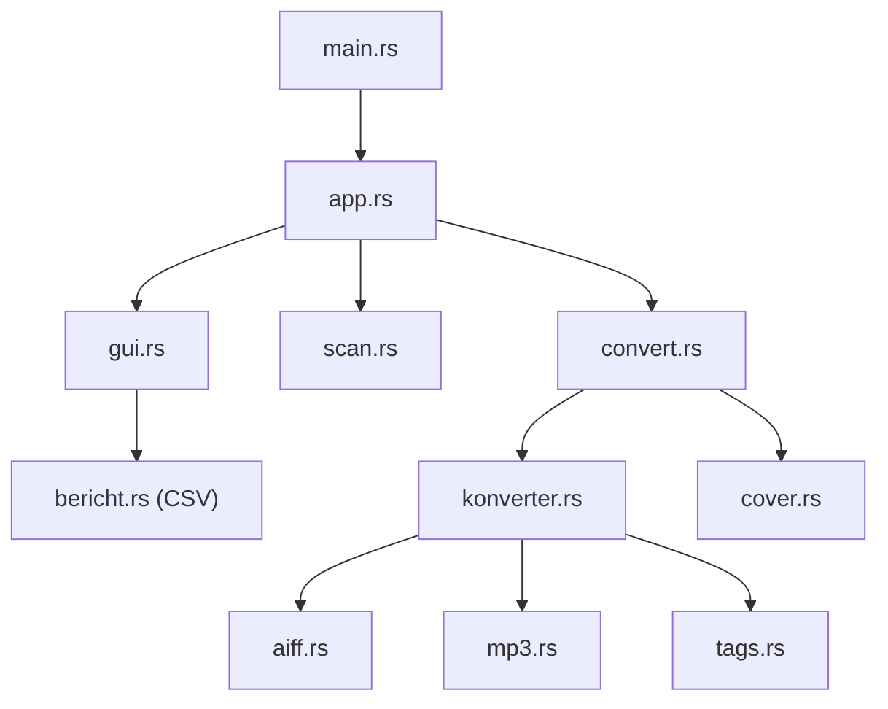

# Audio-Konverter – Wiki

Windows-11-Programm (Rust, egui): wandelt ganze Ordner mit FLAC, WAV, AIFF, MP3 in AIFF (16 Bit, 44,1 kHz) oder MP3 (320 kbit/s) um, für den Pioneer XDJ-700. Der Konverter ist eingebaut, ffmpeg wird nicht mehr benötigt. Protokoll als CSV.



## Seiten
- [funktionen.md](funktionen.md) – was es kann
- [offen.md](offen.md) – was noch fehlt
- [entscheidungen.md](entscheidungen.md) – warum so
- [bekannte-probleme.md](bekannte-probleme.md) – Fehler und Lösung
- [diagramme/](diagramme/) – Mermaid-Diagramme (`ablauf.md`, `architektur.md`)

## Projektstruktur

```
audio-konverter/
├── Cargo.toml
├── src/              main, app, gui, scan, convert, konverter, aiff, mp3, tags, cover, bericht
└── wiki/
```

## Start
- Entwicklung: `cargo run` (langsamer Test) oder `cargo run --release` (wie das Standalone-Programm, 60 Tracks in ca. 19 s)
- Fertige Datei: `cargo build --release`

## Regeln
KISS, YAGNI, Deutsch, kurz halten, bevorzugt Mermaid-Diagramme. Nicht coden, wenn „nichts coden“ gesagt wird.
