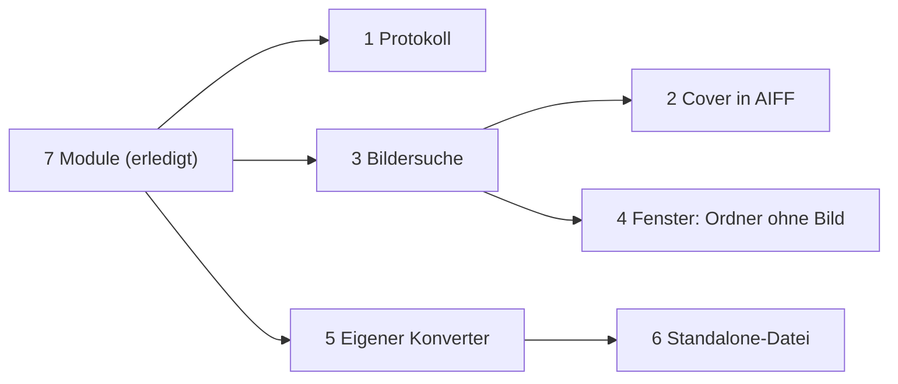

# Noch zu integrieren

| Nr. | Punkt | Modul |
|---|---|---|
| 1 | Protokoll: Datei, Quellformat, Zielformat | `bericht.rs` |
| 2 | Cover in AIFF-Metadaten (Bild liegt im selben Ordner) | `convert.rs` |
| 3 | Bildersuche, Bilder werden gelistet, nie konvertiert | `scan.rs`, `gui.rs` |
| 4 | Extra-Fenster: Ordner ohne Bilddatei | `gui.rs` |
| 5 | Eigener Konverter ersetzt ffmpeg | `convert.rs` |
| 6 | Standalone-Datei ohne Rust und ohne Installation | Build |
| 7 | Code in Module aufteilen | **erledigt** |

Außerdem später: Builds für macOS und Linux Mint über GitHub Actions.
