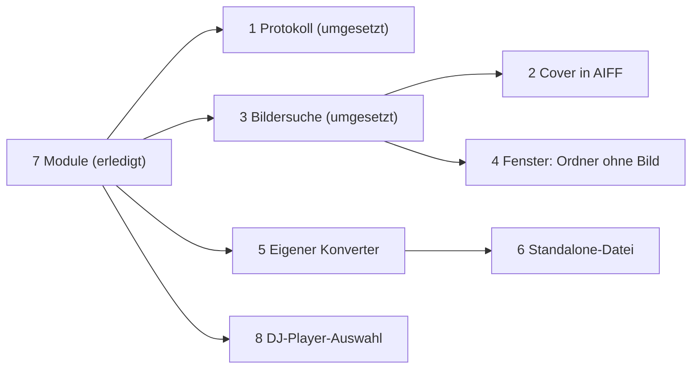

# Noch zu integrieren

| Nr. | Punkt | Modul | Stand |
|---|---|---|---|
| 1 | Protokoll als CSV | `bericht.rs` | umgesetzt, noch nicht getestet |
| 2 | Cover in AIFF-Metadaten (Bild liegt im selben Ordner) | `convert.rs` | offen |
| 3 | Bildersuche, Bilder werden gelistet, nie konvertiert | `scan.rs`, `gui.rs` | umgesetzt, noch nicht getestet |
| 4 | Extra-Fenster: Ordner ohne Bilddatei | `gui.rs` | offen |
| 5 | Eigener Konverter ersetzt ffmpeg | `convert.rs` | offen |
| 6 | Standalone-Datei ohne Rust und ohne Installation | Build | offen |
| 7 | Code in Module aufteilen | | erledigt |
| 8 | DJ-Player (DJ-Controller) auswählbar, zeigt die unterstützten Formate. Pioneer- und Denon-Player | `player.rs`, `gui.rs` | offen |

Außerdem später: Builds für macOS und Linux Mint über GitHub Actions.

Zu Punkt 8: Die Formate jedes Modells müssen einzeln recherchiert und fest im Programm hinterlegt werden (Beispiel: XDJ-700 spielt MP3, AAC, WAV, AIFF, kein FLAC).
