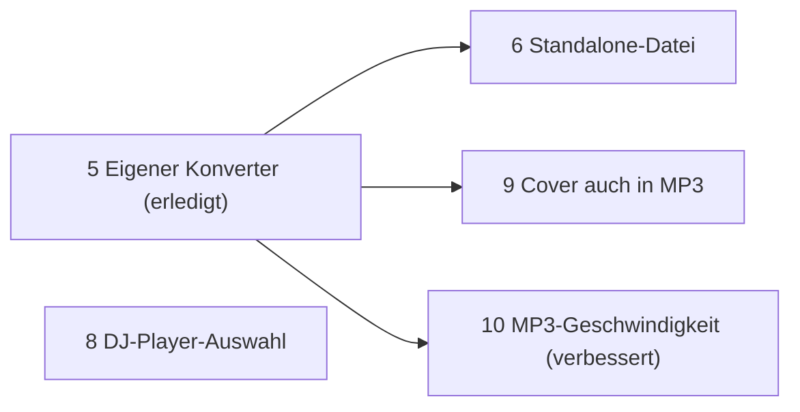

# Noch zu integrieren

| Nr. | Punkt | Modul | Stand |
|---|---|---|---|
| 6 | Standalone-Datei ohne Rust und ohne Installation, muss wie `cargo run --release` schnell laufen | Build | offen |
| 8 | DJ-Player (DJ-Controller) auswählbar, zeigt die unterstützten Formate. Pioneer- und Denon-Player | `player.rs`, `gui.rs` | offen |
| 9 | Cover auch in die Metadaten von MP3 schreiben (bisher nur bei AIFF) | `app.rs` | offen |
| 10 | MP3-Umwandlung beschleunigen | `auftraege.rs` | verbessert, auf deinem PC neu messen |
| 2 | Cover in AIFF-Metadaten | `app.rs`, `tags.rs` | umgesetzt, per Test geprüft, von dir noch nicht getestet |
| 4 | Fenster „Ordner ohne Bild“ (jetzt Fenster „Cover“) | `gui.rs` | umgesetzt, von dir noch nicht getestet |

Erledigt: 1 Protokoll als CSV, 3 Bildersuche, 5 Eigener Konverter, 7 Aufteilung in Module.

Zu Punkt 9: Eine Zeile in `app.rs` (`starten`): die Bedingung `ziel == Ziel::Aiff` beim Cover entfernen.

Zu Punkt 10: Vorher 60 Tracks nach MP3 in ca. 6:30 min, weil LAME nur einen Kern nutzt. Jetzt laufen mehrere Dateien gleichzeitig, ein Thread pro Kern. Gemessen hier: 1 Kern 9,1 s, 2 Kerne 5,0 s für dieselben Dateien. Auf 8 Kernen sollte es grob bei einer Minute liegen.

Zu Punkt 6: Messung im Release-Build: 60 Tracks (WAV und FLAC) nach AIFF in 19 s.

Zu Punkt 8: Die Formate jedes Modells müssen einzeln recherchiert und fest im Programm hinterlegt werden (Beispiel: XDJ-700 spielt MP3, AAC, WAV, AIFF, kein FLAC).

Außerdem später: Builds für macOS und Linux Mint über GitHub Actions.
