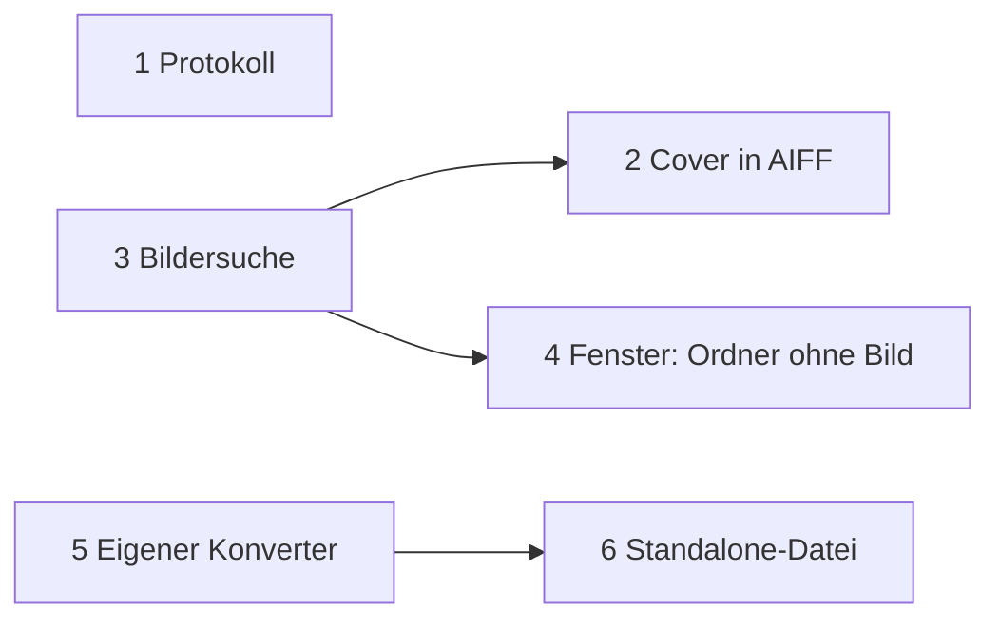

# Noch zu integrieren

1. **Protokoll:** Dokument mit Datei, Quellformat, Zielformat.
2. **Cover in AIFF:** Bild aus demselben Ordner in die Metadaten einbetten.
3. **Bildersuche:** Bilder werden gelistet, nie konvertiert.
4. **Extra-Fenster:** zeigt Ordner ohne Bilddatei.
5. **Eigener Konverter:** ersetzt ffmpeg.
6. **Standalone-Datei:** läuft ohne Rust und ohne Installation.

Danach: Code in Module aufteilen, Builds für macOS und Linux Mint über GitHub Actions.
