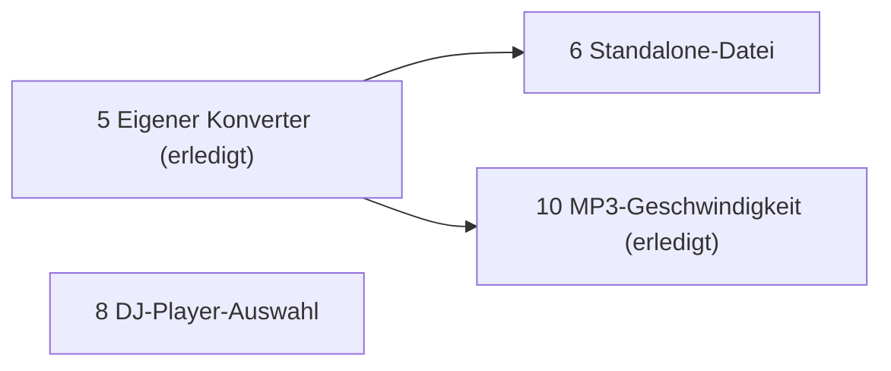

# Noch zu integrieren

| Nr. | Punkt | Modul | Stand |
|---|---|---|---|
| 6 | Standalone-Datei ohne Rust und ohne Installation, muss wie `cargo run --release` schnell laufen | Build | offen |
| 8 | DJ-Player (DJ-Controller) auswählbar, zeigt die unterstützten Formate. Pioneer- und Denon-Player | `player.rs`, `gui.rs` | offen |
| 11 | Umwandlung nach FLAC (WAV / AIFF nach FLAC), nur falls gewünscht | `konverter.rs` | offen |
| 9 | Cover auch in die Metadaten von MP3 schreiben | `app.rs` | erledigt |
| 10 | MP3-Umwandlung beschleunigen | `auftraege.rs` | erledigt |
| 2 | Cover in AIFF-Metadaten | `app.rs`, `tags.rs` | erledigt |
| 4 | Fenster „Ordner ohne Bild“ (jetzt Fenster „Cover“) | `gui.rs` | erledigt |

Erledigt: 1 Protokoll als CSV, 2 Cover in AIFF, 3 Bildersuche, 4 Fenster „Cover“, 5 Eigener Konverter, 7 Aufteilung in Module, 9 Cover in MP3, 10 MP3-Geschwindigkeit.

Zu Punkt 9: In `app.rs` (`starten`) entfiel die Bedingung `ziel == Ziel::Aiff` beim Cover. Per Test und ffprobe geprüft (APIC-Frame, 500×500 JPEG). Ordner ohne eigenes Bild bekommen kein Cover, auch Unterordner nicht.

Zu Punkt 10: Vorher 60 Tracks nach MP3 in ca. 6:30 min, weil LAME nur einen Kern nutzt. Jetzt laufen mehrere Dateien gleichzeitig, ein Thread pro Kern. Gemessen auf deinem PC: 60 Tracks WAV/FLAC nach MP3 in 34 s, nach AIFF in 4 s.

Zu Punkt 6: Messung im Release-Build: 60 Tracks (WAV und FLAC) nach AIFF in 19 s.

Zu Punkt 11: Wird ergänzt, falls eine Umwandlung nach FLAC integriert werden soll. Die Ausgabe ist dann nicht mehr nur AIFF und MP3. Die Geräteliste (`wiki/dj-player.md`) zeigt, dass FLAC nicht bei allen Playern geht.

Zu Punkt 8: Die Formate jedes Modells müssen einzeln recherchiert und fest im Programm hinterlegt werden (Beispiel: XDJ-700 spielt MP3, AAC, WAV, AIFF, kein FLAC).

Außerdem später: Builds für macOS und Linux Mint über GitHub Actions.
