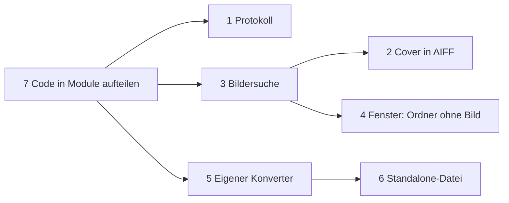

# Noch zu integrieren

1. **Protokoll:** Dokument mit Datei, Quellformat, Zielformat.
2. **Cover in AIFF:** Bild aus demselben Ordner in die Metadaten einbetten.
3. **Bildersuche:** Bilder werden gelistet, nie konvertiert.
4. **Extra-Fenster:** zeigt Ordner ohne Bilddatei.
5. **Eigener Konverter:** ersetzt ffmpeg.
6. **Standalone-Datei:** läuft ohne Rust und ohne Installation.
7. **Code in Module aufteilen:** vor dem Start der Punkte 1 bis 5. Die jetzige `main.rs` (ca. 500 Zeilen) würde sonst auf über 1.500 Zeilen wachsen, und ich kann bei kleinen Änderungen nur die betroffene Datei liefern.

| Datei | Aufgabe |
|---|---|
| `main.rs` | nur Start des Programms |
| `app.rs` | Zustand und Ablaufsteuerung (Ordner, Dateiliste, Start, Abbruch) |
| `gui.rs` | Seitenleiste, Tabelle, Fußleiste, später das Extra-Fenster |
| `scan.rs` | Ordner durchsuchen (Audiodateien, später Bilddateien) |
| `convert.rs` | Umwandlung, zuerst ffmpeg, später der eigene Konverter |
| `bericht.rs` | Protokoll der umgewandelten Dateien |

Die Aufteilung ändert nichts an der Funktion. Vorteil: `convert.rs` lässt sich später austauschen, ohne die Oberfläche anzufassen.

Außerdem später: Builds für macOS und Linux Mint über GitHub Actions.
