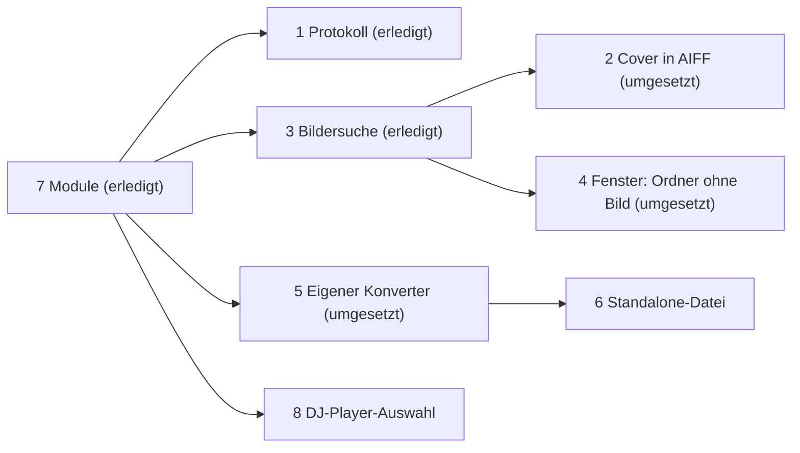

# Noch zu integrieren

| Nr. | Punkt | Modul | Stand |
|---|---|---|---|
| 6 | Standalone-Datei ohne Rust und ohne Installation, muss wie `cargo run --release` schnell laufen | Build | offen |
| 8 | DJ-Player (DJ-Controller) auswählbar, zeigt die unterstützten Formate. Pioneer- und Denon-Player | `player.rs`, `gui.rs` | offen |

Umgesetzt, noch nicht getestet: 2 Cover in AIFF-Metadaten (`cover.rs`), 4 Fenster „Ordner ohne Bild“ (`gui.rs`), 5 Eigener Konverter (`konverter.rs`, `aiff.rs`, `mp3.rs`, `tags.rs`).

Erledigt: 1 Protokoll als CSV, 3 Bildersuche (gelistet, nie konvertiert), 7 Aufteilung in Module.

Zu Punkt 2: Das erste Bild (alphabetisch) im Ordner der Quelldatei wird eingebettet. Nur bei Ziel AIFF.

Zu Punkt 4: Der Knopf „Ordner ohne Bild“ zeigt die Anzahl und öffnet ein Fenster mit allen Ordnern, die Audiodateien aber kein Bild enthalten.

Zu Punkt 5: Der Konverter liest mit symphonia (FLAC, WAV, AIFF), rechnet mit rubato auf 44,1 kHz um, rundet mit Dither auf 16 Bit und schreibt AIFF selbst oder MP3 mit eingebautem LAME. Tags (Titel, Künstler, Album, Album-Künstler, Genre, Jahr, Track, Disc, Komponist, BPM, Label) werden übernommen, Kommentare nicht. ffmpeg wird nicht mehr gebraucht.

Zu Punkt 6: Messung im Release-Build: 60 Tracks (WAV und FLAC) nach AIFF in 19 s.

Außerdem später: Builds für macOS und Linux Mint über GitHub Actions.

Zu Punkt 8: Die Formate jedes Modells müssen einzeln recherchiert und fest im Programm hinterlegt werden (Beispiel: XDJ-700 spielt MP3, AAC, WAV, AIFF, kein FLAC).
