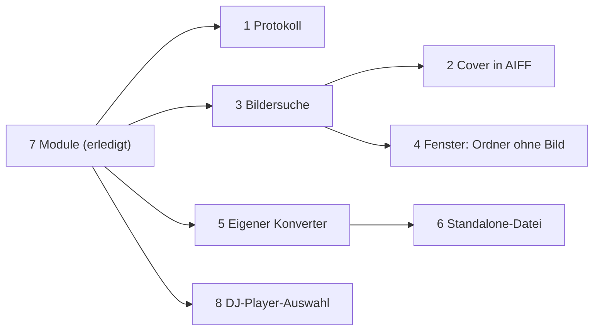

# Noch zu integrieren

| Nr. | Punkt | Modul |
|---|---|---|
| 1 | Protokoll: Datei, Quellformat, Zielformat | `bericht.rs` |
| 2 | Cover in AIFF-Metadaten (Bild liegt im selben Ordner) | `convert.rs` |
| 3 | Bildersuche, Bilder werden gelistet, nie konvertiert | `scan.rs`, `gui.rs` |
| 4 | Extra-Fenster: Ordner ohne Bilddatei | `gui.rs` |
| 5 | Eigener Konverter ersetzt ffmpeg | `convert.rs` |
| 6 | Standalone-Datei ohne Rust und ohne Installation | Build |
| 7 | Code in Module aufteilen | **erledigt** |
| 8 | DJ-Player (DJ-Controller) auswählbar, das Programm zeigt gleich an, welche Formate der Player spielt. Gilt für Pioneer- und Denon-Player | `player.rs` (Modelle und Formate), `gui.rs` (Auswahl und Anzeige) |

Außerdem später: Builds für macOS und Linux Mint über GitHub Actions.

Zu Punkt 8: Die Liste der Modelle und ihrer unterstützten Formate muss pro Modell recherchiert und fest im Programm hinterlegt werden (Beispiel: XDJ-700 spielt MP3, AAC, WAV, AIFF, kein FLAC).
