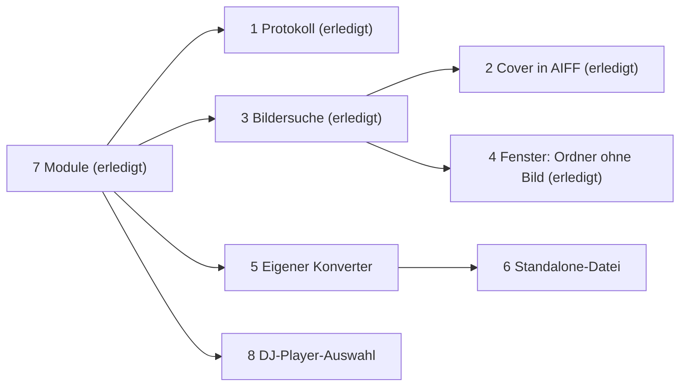

# Noch zu integrieren

| Nr. | Punkt | Modul | Stand |
|---|---|---|---|
| 5 | Eigener Konverter ersetzt ffmpeg | `convert.rs` | offen |
| 6 | Standalone-Datei ohne Rust und ohne Installation | Build | offen |
| 8 | DJ-Player (DJ-Controller) auswählbar, zeigt die unterstützten Formate. Pioneer- und Denon-Player | `player.rs`, `gui.rs` | offen |

Erledigt: 1 Protokoll als CSV, 2 Cover in AIFF-Metadaten, 3 Bildersuche (gelistet, nie konvertiert), 4 Fenster „Ordner ohne Bild“, 7 Aufteilung in Module.

Zu Punkt 2: Das erste Bild (alphabetisch) im Ordner der Quelldatei wird als AIFF-Cover eingebettet (`cover.rs`, genutzt von `convert.rs`). Nur bei Ziel AIFF, noch nicht getestet.

Zu Punkt 4: Der Knopf „Ordner ohne Bild“ in der Fußleiste öffnet ein Fenster mit allen Ordnern, die Audiodateien aber kein Bild enthalten. Noch nicht getestet.

Außerdem später: Builds für macOS und Linux Mint über GitHub Actions.

Zu Punkt 8: Die Formate jedes Modells müssen einzeln recherchiert und fest im Programm hinterlegt werden (Beispiel: XDJ-700 spielt MP3, AAC, WAV, AIFF, kein FLAC).
